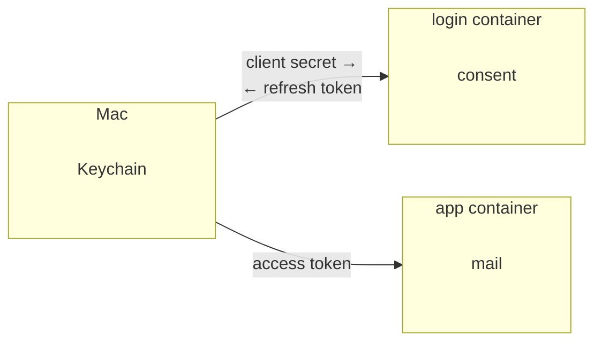

# Personal email assistant

## What it is

- **assistant for my emails** — help with query, grouping, etc.
- **digest** — daily summary of emails
- **part of my [Personal OS](https://github.com/cheslav-zhur/cheslav-zhur)**

## How it runs

Security matters. Mailbox tokens stay in Keychain, and a container receives only what that run needs.

- **Mac.** Keychain holds the OAuth client secret and one refresh token per mailbox.
- **login container.** One run: browser consent, then the container exits and the refresh token goes back into Keychain.
- **app container.** Mail: search and the daily digest. It receives a short-lived access token only.

## Docs

- [Plans](docs/plans/)
- [Development](docs/dev.md)
