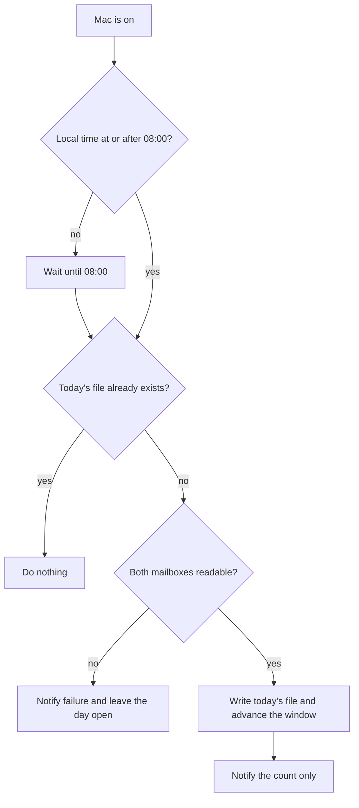
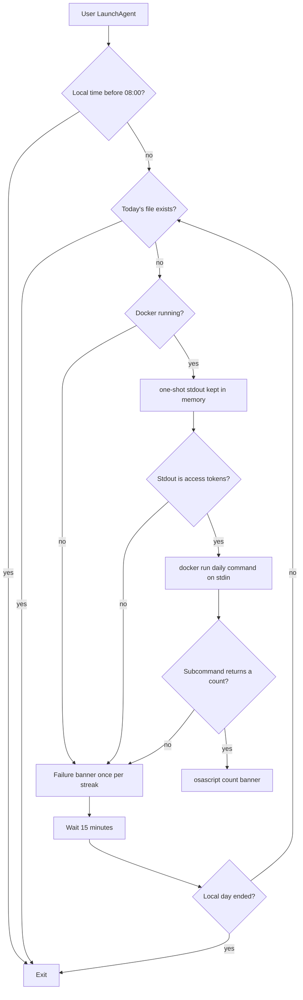

# Local Morning Digest - Plan

## Goal Capsule

- **Objective:** Once the Mac is on at or after 08:00 local time, produce one morning digest for that calendar day as a kept file plus a count-only notification. The owner opens the file.
- **Product authority:** Telegram delivery and a digest that runs while the Mac is off are not active scope. Product behavior in the Product Contract wins over this capsule.
- **Stop conditions:** Stop if the work would send digest text off the Mac, change Gmail read state, or let a manual digest move the morning window.
- **Open blockers:** None.
- **Execution:** code
- **Tail:** Land on the current branch. Do not push or open a pull request unless the owner asks.
- **Product Contract preservation:** changed: Summary, R6, F3 — the notification no longer opens the file. The owner opens the day's file.

---

## Product Contract

### Summary

The Mac produces one morning digest per local day once it is on at or after 08:00. Mail since the previous morning file goes into that day's file, and one notification shows only the count. The owner opens the file.

### Problem Frame

The owner wants a digest on a regular morning rhythm and may not bother to run it by hand. The Mac lid is closed overnight, so the machine does not wake itself to do the job. Sending the digest off the machine is unsettled because the mail is private. Leaving this unbuilt means a digest exists only when the owner remembers the command.

### Key Decisions

- **Run on the Mac once it is on.** (session-settled: user-directed — chosen over a cloud host and over waking the Mac: the lid is closed at night, and the digest stays on the machine for now.) Governs R1.
- **Count only on the notification.** (session-settled: user-directed — chosen over subjects in the banner and over a bare ready notice: the banner can show on the lock screen.) Governs R6.
- **The owner opens the day's file.** (session-settled: user-directed — chosen over a helper that opens the file from the banner and over no banner: the banner shows only the count.) Governs R6.
- **Window starts at the previous morning file.** (session-settled: user-directed — chosen over a rolling 12-hour lookback: 12 hours remains the manual check.) Governs R2, R3.
- **The file write is what marks mail shown.** (session-settled: user-directed — chosen over marking mail when the notification is activated: a later open from the Finder is not observable.) Governs R2, R5.
- **Only the morning run moves the window.** (session-settled: user-directed — chosen over treating every digest run as the marker: a manual check must not empty the next morning.) Governs R4.
- **A quiet morning still leaves a file.** (session-settled: user-approved — chosen over staying silent when nothing is new: the owner can see that the check ran.) Governs R7.
- **A failed read leaves the day open.** (session-settled: user-approved — chosen over consuming the day or staying silent: mail stays eligible and the owner sees the miss.) Governs R8.
- **08:00 follows the Mac clock.** (session-settled: user-approved — chosen over pinning the product rule to a named timezone: the owner's morning is the Mac's local morning.) Governs R1.

<!-- ce-section: work-relationships -->
### How This Work Fits Together

This plan owns the local morning digest that runs when the Mac is on. The nearby work below is the current picture, not a committed roadmap.

- Telegram send of a digest. Can proceed independently of this plan. See `docs/plans/2026-09-26-telegram-digest-send.md`. This plan does not deliver there.
- A digest while the Mac is off. Still to decide. Enables a morning result on days the Mac never turns on.

### Requirements

**When it runs**

- R1. On each local calendar day the morning digest becomes due at 08:00 Mac local time if the Mac is already on, and otherwise at the first moment the Mac is on after 08:00. The duty stays open until that day's file exists or that local calendar day ends. A later day does not create the missed day's file. The next on-day window still starts at the last morning file that was written.

**What it contains**

- R2. A morning digest includes only mail that arrived after the previous morning digest file was written, from both mailboxes, as one text.
- R3. When no morning digest file exists yet, that first digest covers the previous 24 hours instead of R2's window.
- R4. A manual digest does not write a morning file and does not change which mail the next morning digest includes.

**What the owner sees**

- R5. Each successful local calendar day has its own file, and later runs do not replace it. Older files stay available.
- R6. A successful run sends one notification that shows only the number of messages in that day's file. Activating the notification does not open the file, and subjects and senders appear only in the file.
- R7. A due run that finds no new mail still writes that day's file and notifies a count of 0. The file states that there were no new messages, counts as the day's success under R1, and is the previous file for the next R2 window.

**When mail cannot be read**

- R8. When a due run cannot read one of the two mailboxes, it notifies that the digest did not run, writes no file, and leaves the window unchanged. The notification includes no mail content, and per R1 the duty stays open for a later attempt the same day.

### Key Flows

- F1. Catch-up after the Mac comes on
  - **Trigger:** The Mac is off at 08:00 and later turns on with today's file absent.
  - **Actors:** The owner.
  - **Steps:** The duty runs on that later wake. Readable mail is written to today's file. One count-only notification is sent.
  - **Covered by:** R1, R2, R5, R6
- F2. Already on at 08:00
  - **Trigger:** The Mac is on before 08:00 and today's file does not exist.
  - **Actors:** The owner.
  - **Steps:** The duty waits until 08:00, then runs.
  - **Covered by:** R1
- F3. Owner reads the file
  - **Trigger:** Today's file exists.
  - **Actors:** The owner.
  - **Steps:** The owner opens that day's file from its folder. The banner does not open it. Mail in the file is already marked shown by the write.
  - **Covered by:** R2, R5, R6
- F4. Mail cannot be read
  - **Trigger:** The duty is open and either mailbox cannot be read.
  - **Actors:** The owner.
  - **Steps:** No file is written. The window stays put. A notification says the digest did not run. A later attempt the same day can still succeed.
  - **Covered by:** R1, R8

### Acceptance Examples

- AE1. Wake after 08:00
  - **Covers R1, R2, R5, R6.**
  - **Given:** Yesterday's file was written at 08:10, the Mac is off at 08:00, the owner turns it on at 10:30, and new mail arrived at 09:00.
  - **When:** The morning duty runs.
  - **Then:** Today's new file includes the 09:00 mail and omits mail already in yesterday's file. One notification shows the count and does not show subjects or senders.
- AE2. Already on before 08:00
  - **Covers R1.**
  - **Given:** The Mac is on at 07:40 and today's file does not exist.
  - **When:** The clock reaches 08:00.
  - **Then:** The digest runs at 08:00.
- AE3. Mac never turns on
  - **Covers R1.**
  - **Given:** The Mac stays off for the whole local calendar day.
  - **When:** That day ends.
  - **Then:** That day has no file and no notification.
- AE4. Second wake the same day
  - **Covers R1, R5.**
  - **Given:** Today's file already exists.
  - **When:** The Mac wakes again later the same day.
  - **Then:** There is no second file and no second notification.
- AE5. First morning ever
  - **Covers R3.**
  - **Given:** No morning digest file exists, and the Mac is on after 08:00.
  - **When:** The first morning digest runs.
  - **Then:** The file covers the previous 24 hours.
- AE6. Manual check in the afternoon
  - **Covers R4.**
  - **Given:** A morning file exists, and the owner runs a manual digest later that day.
  - **When:** The next morning duty runs.
  - **Then:** The window still starts at the previous morning file, including mail the manual run already showed.
- AE7. Notification never activated
  - **Covers R2, R5, R6.**
  - **Given:** Today's file was written and the owner never activates the notification.
  - **When:** The next morning duty runs.
  - **Then:** Yesterday's file remains, and the new digest does not repeat that mail.
- AE8. Nothing new
  - **Covers R7.**
  - **Given:** The duty is open and no mail arrived after the previous morning file.
  - **When:** The run succeeds.
  - **Then:** Today's file states that there were no new messages, the notification count is 0, and the next window starts at this run.
- AE9. Mail unreadable
  - **Covers R1, R8.**
  - **Given:** The duty is open and one mailbox cannot be read.
  - **When:** The run attempts, and a later attempt the same day can read both mailboxes.
  - **Then:** The first attempt writes nothing and notifies failure without mail content. The later attempt still writes today's file.
- AE10. Both mailboxes
  - **Covers R2, R6.**
  - **Given:** Both mailboxes have new mail since the previous morning file.
  - **When:** The morning digest succeeds.
  - **Then:** One file holds both, and one notification count is the total across both mailboxes.

### Scope Boundaries

**Deferred for later**

- Sending this digest to Telegram. A separate note already covers send-only delivery: `docs/plans/2026-09-26-telegram-digest-send.md`.
- Producing a digest while the Mac is off or asleep with the lid closed.
- Waking the Mac on a schedule so it can run the digest itself.

**Not in this work**

- An interactive Telegram bot.
- Changing read or unread state in Gmail.
- Changing the manual digest command's lookback.
- A notification helper whose click opens the day's file.

**Deferred to Follow-Up Work**

- A host Python install that reads Keychain without Docker.
- Automated checks of launchd, Docker, and the banner on the Mac.

### Dependencies / Assumptions

- The morning run reads the same aliases as a manual digest. Its access tokens come from the host one-shot path and are separate from the open Dev Container copy.
- The two mailboxes are the configured aliases `email1` and `email2`.
- A manual digest still defaults to `EMAILS_ASSISTANT_SINCE_HOURS` or 12 hours. This work does not change that default.
- An OAuth app left in Testing expires refresh tokens about every 7 days. When access has lapsed, R8 applies until the owner restores it on the Mac.

### Sources / Research

- `docs/dev.md` records `TZ` as `Asia/Ho_Chi_Minh` for the dev environment. R1 follows the Mac clock rather than hard-coding that zone.
- `docs/solutions/tooling-decisions/2026-09-25-gmail-api-oauth-readonly-python.md` records Keychain without biometrics so a host job can read tokens, and the 7-day Testing expiry.
- `docs/plans/2026-09-26-telegram-digest-send.md` is the separate Telegram send note.
- `src/emails_assistant/cli.py` already runs a manual digest and `digest --telegram`. This plan leaves that lookback alone.

---

## Planning Contract

### Key Technical Decisions

- KTD1. **Schedule with a per-user LaunchAgent.** `StartCalendarInterval` at 08:00 and `RunAtLoad` cover an already-awake Mac and a login after 08:00. The job exits when today's file exists. If Mac local time is before 08:00, the job exits with no file, no banner, and no one-shot call. `launchd.plist(5)` starts a calendar job missed during sleep on the next wake. Cron would skip that slot. The agent does not wake the Mac. Governs R1.
- KTD2. **Run the morning command through `docker run --rm` from the host.** The host does not read Keychain. It keeps `scripts/macos-access-token.sh one-shot` stdout in memory and pipes that stdout to the container on stdin. The morning command writes `/dev/shm/emails-assistant/access-<alias>.json` inside that container, as user `vscode`, and reads mail from those files. It does not mount a credential directory and does not pass the token with `-e`. If Docker is not running, or one-shot fails, the host does not start Python. It notifies failure, writes no file, and leaves the window unchanged, the same outcome as R8. (session-settled: user-approved — chosen over a host Python install and over a Keychain directory mount: plan 001 already hands the morning job a one-shot access token, and a host install would require new packages.) Governs R1, R8.
- KTD3. **Daily is its own subcommand.** `digest` stays print-only and does not write the day file. Governs R4.
- KTD4. **The window is a Gmail `after:` cutoff.** Use the previous morning file's modification time as a UTC epoch. The first run uses the previous 24 hours. The morning query must not stop at the 100-message cap in `list_recent_messages`. Governs R2, R3.
- KTD5. **Notify with `osascript` `display notification`.** Pass the count, or a failure line with no mail content. Do not pass subjects, senders, or tokens on the command line. The command does not open the file. (session-settled: user-directed — chosen over a helper that opens the file and over no banner: the built-in banner shows the count.) Governs R6, R7, R8.
- KTD6. **Store day files outside the git worktree.** One file per local calendar day, named by that date, under `~/Library/Application Support/emails-assistant/digests` unless `EMAILS_ASSISTANT_DAILY_DIR` overrides it. Governs R5.
- KTD7. **Test the morning rules with pytest.** Cover the window, the once-a-day file, a failed read, and a zero-mail file. Do not call Gmail, Keychain, Docker, or `osascript` from the suite. Add pytest as a dev extra. Do not install it until the owner says ok. (session-settled: user-directed — chosen over deferring every check: the morning rules are tested now, and the Mac run stays manual.) Governs R2, R3, R4, R7, R8.
- KTD8. **One Dockerfile for the Dev Container and the morning run.** It starts from `mcr.microsoft.com/devcontainers/python:3.12-bookworm` and installs `requirements.txt`. `.devcontainer/devcontainer.json` builds that file. GitHub CLI and Node stay devcontainer features. `postCreateCommand` still installs the package editable from the mounted workspace. The morning `docker run` uses an image built from the same Dockerfile, mounts the repo at the same path, and imports the mounted package. The owner builds that image once when installing the agent, and again when `requirements.txt` changes. The 08:00 run does not pip install and does not `docker exec` the open Dev Container. (session-settled: user-approved — chosen over a morning-only image and over leaving the recipe open: one file keeps both on the same base image and the same requirements.) Governs R1, R8.

### High-Level Technical Design

The host owns the clock, the one-shot call, and the banner. It does not read Keychain. The daily subcommand writes today's file on the mounted daily directory and prints only a count or a failure line with no mail content. The host passes that line to `osascript` and does not write the file. Digest text and tokens stay off the `osascript` argument list and off the host disk.

### Assumptions

- A locked login keychain makes `scripts/macos-access-token.sh one-shot` fail. The morning host then notifies failure and writes no file, the same outcome as R8. This session did not re-check that failure against a current Apple doc.
- `launchd.plist(5)` coalesces a calendar slot missed during sleep into one run on wake. A Mac that never turns on that day gets no run, per R1.
- Docker is the container runtime on the Mac. The morning `docker run` uses the image from KTD8, with its own `/dev/shm`, the repo mounted at the Dev Container path, and the daily directory mounted.

### Sequencing

U1 has no network. U2 calls Gmail through the rules from U1. U3 is the host wrapper around U2.

### Sources / Research

- `launchd.plist(5)` states that `StartCalendarInterval`, unlike cron, runs a job missed during sleep on the next wake.
- The archived AppleScript Language Guide documents `display notification` with message, title, subtitle, and sound name, and no parameter that opens a file.
- `docs/dev.md` describes `scripts/macos-access-token.sh one-shot`: access token and expiry on stdout, kept in memory, separate from the Dev Container tmpfs. KTD2 consumes that stdout.
- `src/emails_assistant/gmail_api.py` `search_messages` accepts an arbitrary query and stops at `max_results`. `list_recent_messages` defaults that cap to 100.

---

## Implementation Units

### U1. Morning rules

- **Goal:** Decide the window, the day file, and the notification count without talking to Gmail.
- **Requirements:** R2, R3, R5, R7, R8. Covers AE4, AE5, AE7, AE8, AE9.
- **Dependencies:** None.
- **Files:** `src/emails_assistant/daily.py`, `tests/test_daily_rules.py`, `pyproject.toml`
- **Approach:** Pure functions take the existing day files, a clock, and mailbox results. They return whether to write, the file text, and the count. Per KTD4 and KTD6. Per KTD7, add pytest as a dev extra and do not install it until the owner says ok.
- **Execution note:** Write the failing rule tests before the Gmail subcommand.
- **Patterns to follow:** `src/emails_assistant/digest.py` for section text and the empty-mailbox line. Keep subjects out of the count string, per R6.
- **Test scenarios:**
  - Covers AE5. No prior file and clock T. The window starts 24 hours before T.
  - Prior file modified at M. A message at M is outside the window. A message after M is inside.
  - Covers AE4. Today's file already exists. The decision is to leave it and send no notification.
  - Covers AE8. No messages in the window. The file text states that there were no new messages, and the count is 0.
  - Covers AE9. One mailbox result is an error. The decision writes nothing, and the prior file stays the window start.
  - Two mailboxes return 2 and 3 messages. The count is 5, and the file text includes both aliases.
- **Verification:** `python -m pytest tests/test_daily_rules.py` passes after pytest is installed.

### U2. Morning subcommand

- **Goal:** Read both mailboxes and write today's file only after both reads succeed.
- **Requirements:** R2, R3, R4, R8. Covers AE6, AE9, AE10.
- **Dependencies:** U1
- **Files:** `src/emails_assistant/cli.py`, `src/emails_assistant/gmail_api.py`, `src/emails_assistant/daily.py`, `tests/test_daily_command.py`
- **Approach:**
  - Add a `daily` subcommand next to `digest`. Leave `digest` print-only, per KTD3. Do not call Telegram.
  - Read stdin as one JSON object per configured alias, in `EMAILS_ASSISTANT_ACCOUNTS` order, matching `one-shot` stdout. Each object is `access_token` and `expiry` only, per KTD2.
  - Validate with `load_access_credentials` before any file write. A refresh token, a client secret, a due token, or a line count that does not match the alias list is a read failure: no day file and a failure signal, per R8.
  - Write each accepted payload with `write_access_token_file`, then load mail the way `digest` does.
  - Build the `after:` query from U1 and page `search_messages` until the window is consumed, per KTD4.
  - Write the day file only after both aliases succeed. Stdout is only the count or the failure line.
- **Patterns to follow:** `cli.py` `write_access_token_file` for the tmpfs file. `auth.py` `load_access_credentials` for the bearer payload. `cli.py` digest handler for alias resolution after those files exist. `search_messages` for the query. Do not route the morning path through `list_recent_messages`.
- **Test scenarios:**
  - Covers AE10. Two stdin payloads for `email1` and `email2`, then fake mailbox results, become one file and a count equal to the sum. The day file contains no access token.
  - The Gmail query uses `after:` and the previous file's epoch. It does not use `newer_than`.
  - 120 matching messages are all included. The run does not stop at 100.
  - Covers AE6. Running `digest` prints text and does not create or replace a morning file.
  - Covers AE9. The second alias raises. No morning file is written, and the command reports failure without a subject in the error text.
  - Stdin has one payload that includes `refresh_token`. No morning file is written, and the failure text contains no token and no subject.
  - Stdin has three payloads for two aliases. No morning file is written.
- **Verification:** `python -m pytest tests/test_daily_command.py` passes. A manual `digest` run still prints and does not write under the daily directory.

### U3. Host agent

- **Goal:** Run the daily subcommand on the Mac when the duty is open, and show the banner.
- **Requirements:** R1, R6, R8. Covers F1, F2, F4, AE1, AE2, AE3, AE9.
- **Dependencies:** U2
- **Files:** `Dockerfile`, `.devcontainer/devcontainer.json`, `scripts/macos-daily.sh`, `scripts/com.emails-assistant.daily.plist`, `.env.example`, `docs/dev.md`
- **Approach:**
  - Install a per-user LaunchAgent per KTD1.
  - If today's file exists, exit.
  - If Mac local time is before 08:00, exit with no file, no banner, and no one-shot call.
  - Add the Dockerfile and point the Dev Container build at it, per KTD8. Document the one-time `docker build` for the morning image, and a rebuild when `requirements.txt` changes, in `docs/dev.md`.
  - After 08:00, repeat until today's file exists or the local calendar day ends. On each try: if Docker is not running, do not call one-shot. Otherwise run `scripts/macos-access-token.sh one-shot`, keep that stdout in memory, per KTD2, and on success pipe it to `docker run --rm -i -u vscode` of the KTD8 image. Mount the repo at the Dev Container path, the Mac timezone, and the daily directory. Import the mounted package. Do not mount a credential directory, echo or export the token, pip install, or `docker exec` the open Dev Container.
  - A Docker miss, a one-shot failure, or a daily-command failure sends the failure banner once for that streak, writes no file, then waits 15 minutes. The count banner is sent only when a try writes today's file, per KTD5.
  - Document the copy into `~/Library/LaunchAgents` and `launchctl bootstrap` in `docs/dev.md`.
- **Patterns to follow:** `scripts/macos-access-token.sh` `one-shot` for the access-token stdout. `docs/dev.md` host-versus-container section for keeping that stdout in memory.
- **Test scenarios:**
  - The agent loads at 07:40 and today's file is absent. The run does not call one-shot, does not write a file, and does not show a banner.
  - Docker is running, one-shot prints two access-token payloads, today's file is absent, and the Mac local time is after 08:00. One run writes today's file and shows a count banner with no subjects and no token.
  - The same day runs again. The file is unchanged and no second banner is sent.
  - Covers AE9. At 08:00 Docker is stopped. No file is written, one-shot is not called, and one failure banner contains no subject or sender. Fifteen minutes later Docker is running and one-shot succeeds. Today's file is written, one count banner is sent, and no second failure banner is sent.
  - one-shot exits with the re-login notice. The container does not start, no file is written, and the one failure banner for that streak contains no token and no subject. A later try the same day can still write the file.
- **Verification:** On the Mac, with Docker running and Keychain unlocked, one due run writes today's file and shows a count banner. A second run the same day does not write again. With Docker stopped, the failure banner appears and no file is written.

---

## Verification Contract

- Install pytest only after the owner says ok. Then `python -m pytest` passes `tests/test_daily_rules.py` and `tests/test_daily_command.py`.
- `digest` still defaults to `EMAILS_ASSISTANT_SINCE_HOURS` or 12 hours and does not write a morning file.
- On the Mac, the U3 checks hold: one file and a count banner when Docker is up, no second file the same day, and a Docker miss at 08:00 that still writes the file on a later try the same day after one failure banner.
- The git diff contains no token, no `.env`, and no digest body. The morning host does not write one-shot stdout to a file.

---

## Definition of Done

- U1, U2, and U3 meet their verification.
- R1 through R8 hold, including a banner that does not open the file.
- The manual digest lookback is unchanged.
- Day files and tokens stay outside git.
- Abandoned experiment code is not left in the diff.
- The Dev Container and the morning run build from the same Dockerfile.
