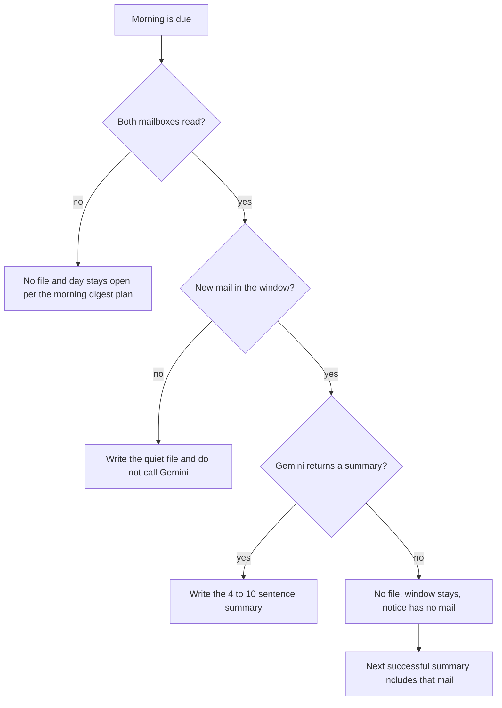

# Mail Summary - Plan

## Goal Capsule

- **Objective:** When the morning window has new mail, the day's file is a Gemini summary of what is important, about 4 to 10 sentences, billed to the Gmail Cloud project so the welcome credit pays.
- **Product authority:** Draft replies, a separate triage feature, and which provider to use after the welcome credit ends are not active scope.
- **Open blockers:** None.
- **Execution:** code

---

## Product Contract

### Summary

The morning file stops listing messages. On a morning with new mail it holds one Gemini summary of what is important across both mailboxes, about 4 to 10 sentences. The call is billed to the same Google Cloud project as Gmail access. If Gemini does not return a summary, that mail waits for the next successful one.

### Problem Frame

The morning file is the list of mail since the previous morning file, and the banner shows only a count. The owner wants that file to say what matters. A Google Cloud welcome credit can pay for Google's model when the call is billed to the Cloud project, and it does not pay an AI Studio key. The credit expires. Leaving the file as a list spends none of it on mail, and the morning read stays the list.

### Key Decisions

- **The morning file is the summary.** (session-settled: user-directed — chosen over a separate summary run and over a billing-only ping: the welcome credit is spent on the file the owner already opens.) Governs R1.
- **One pool of what is important.** (session-settled: user-directed — chosen over a sentence per mailbox and over a line that the rest can be ignored: a quiet mailbox may be absent.) Governs R3.
- **About 4 to 10 sentences.** (session-settled: user-directed — chosen over a ceiling of 7 and over a hard 4–7 band: this is the range to try on real mornings.) Governs R2.
- **Gemini billed to the Gmail Cloud project.** (session-settled: user-directed — chosen over an AI Studio API key and over OpenRouter: the welcome credit pays project-billed Gemini and does not pay an AI Studio key.) Governs R4.
- **Morning mail may be sent to Gemini.** (session-settled: user-directed — chosen over keeping the morning text only on the Mac: the owner allowed this mail to go to the cloud.) Governs R5.
- **A model miss leaves the window open.** (session-settled: user-directed — chosen over a failure file that closes the day and over writing the message list: the mail waits for the next successful summary.) Governs R7, R8, R10.
- **A quiet morning does not call the model.** (session-settled: user-approved — chosen over a Gemini call that only says nothing arrived: the owner confirmed the synthesis.) Governs R6.
- **The banner count is the message count.** (session-settled: user-approved — chosen over announcing that one summary exists: the owner confirmed the synthesis.) Governs R9.

<!-- ce-section: work-relationships -->
### How This Work Fits Together

This plan owns the morning-file summary and the Gemini call that writes it. The list below is the current picture, not a committed roadmap.

- Local morning digest. This plan depends on it for when the morning runs, which mail is in the window, the count-only banner, the quiet-morning file, and a failed mailbox read. This plan replaces that plan's file body. See `docs/plans/2026-09-28-002-feat-local-morning-digest-plan.md`.
- A separate triage feature. Still to decide. Can proceed independently of this plan.
- Draft replies. Still to decide. Can proceed independently of this plan.
- Which provider to use after the welcome credit ends. Still to decide. This plan does not switch providers when the credit runs out.
- Telegram send of a digest. Can proceed independently of this plan. See `docs/plans/2026-09-26-telegram-digest-send.md`.

### Actors

- A1. Owner. Opens the morning file and sees a miss notice when the summary does not run.
- A2. Morning run. Writes the day's file or leaves the window unchanged.

### Requirements

**What the file holds**

- R1. When the morning window has new mail, that day's file is a summary of what is important and does not list the window's messages.
- R2. The R1 summary is about 4 to 10 sentences.
- R3. R1 judges both mailboxes as one pool, and a mailbox may go unmentioned when nothing in it is important.

**Who produces it**

- R4. R1 is produced by Gemini billed to the same Google Cloud project used for Gmail access.
- R5. The R4 call may receive mail from the morning window.

**Empty mornings and misses**

- R6. When the morning window has no new mail, the day's file states that there were no new messages and no model is called.
- R7. When Gemini does not return a summary, no morning file is written and the window does not advance.
- R8. Mail left unsummarized under R7 appears only in the next successful R1 summary.
- R9. On success the notification shows how many messages were in the window, not how many sentences the summary has.
- R10. An R7 miss notifies the owner that the summary did not run, and the notice includes no mail content.

### Key Flows

- F1. Morning with new mail
  - **Trigger:** The morning run is due, both mailboxes were read, and the window has new mail.
  - **Actors:** A2, then A1
  - **Steps:** Gemini summarizes what is important across both mailboxes. The day's file is that summary. One notification shows the message count.
  - **Outcome:** A1 opens a file of about 4 to 10 sentences and no message list.
  - **Covered by:** R1, R2, R3, R4, R5, R9
- F2. Quiet morning
  - **Trigger:** The morning run is due, both mailboxes were read, and the window has no new mail.
  - **Actors:** A2
  - **Steps:** No model is called. The day's file states that there were no new messages. The notification count is 0.
  - **Covered by:** R6, R9
- F3. Gemini does not return a summary
  - **Trigger:** The window has new mail and Gemini does not return a summary.
  - **Actors:** A2, A1
  - **Steps:** No file is written. The window stays. A1 is notified without mail content. A later successful morning includes that mail in its summary.
  - **Covered by:** R7, R8, R10

### Acceptance Examples

- AE1. Both mailboxes have new mail and Gemini returns a summary
  - **Covers R1, R2, R3, R9.**
  - **Given:** Both mailboxes have new mail since the previous morning file.
  - **When:** Gemini returns a summary.
  - **Then:** Today's file is about 4 to 10 sentences, does not list the messages, and one notification shows the message count across both mailboxes.
- AE2. One mailbox has nothing important
  - **Covers R3.**
  - **Given:** One mailbox has mail the summary judges important and the other does not.
  - **When:** R1 is written.
  - **Then:** The summary may omit the quiet mailbox.
- AE3. No new mail
  - **Covers R6, R9.**
  - **Given:** The window has no new mail.
  - **When:** The morning run finishes.
  - **Then:** The file states that there were no new messages, no model is called, and the notification count is 0.
- AE4. Gemini misses, then a later morning succeeds
  - **Covers R7, R8, R10.**
  - **Given:** The window has new mail and Gemini does not return a summary.
  - **When:** A later morning succeeds.
  - **Then:** The missed run writes no file and notifies without mail content. The missed calendar day does not get its own file. The later summary includes the mail the miss left behind.

### Scope Boundaries

- Draft replies.
- A separate triage feature. R3 is a summary of what is important, not that feature.
- OpenRouter and an AI Studio API key.
- Choosing a provider when the welcome credit ends. Until then, R4 stays Gemini on the Gmail Cloud project.
- Changing the 4 to 10 sentence range after real mornings.
- The manual digest, the morning schedule, the window, where the file is stored, and a failed mailbox read. Those stay in `docs/plans/2026-09-28-002-feat-local-morning-digest-plan.md`.

### Dependencies / Assumptions

- This plan assumes the Google Cloud project used for Gmail access is the billing account that holds the welcome credit. If it is not, R4 does not spend that credit.
- A failed mailbox read is unchanged from the morning digest plan: no file, a notice with no mail content, and the day stays open. R7 applies only after both mailboxes were read.
- The welcome credit does not pay Gemini API usage in AI Studio. It can pay Gemini billed to the Cloud project. See Sources.

### Outstanding Questions

**Deferred to Planning**

- Which parts of each message the R5 call sends, as long as R1 can still judge what is important.

### Sources / Research

- `docs/plans/2026-09-28-002-feat-local-morning-digest-plan.md` — morning window, quiet file, count-only banner, failed mailbox read.
- `README.md` — mailbox contents go to a third-party API only when the owner asks. R5 is that ask.
- [Google Cloud Free Trial](https://docs.cloud.google.com/free/docs/free-cloud-features) — the $300 welcome credit cannot pay for Gemini API in AI Studio, and it cannot pay for a partner model sold as a managed API.
- [Gemini Enterprise Agent Platform](https://cloud.google.com/products/gemini-enterprise-agent-platform) — new customers can spend the welcome credit on this platform, formerly Vertex AI.
