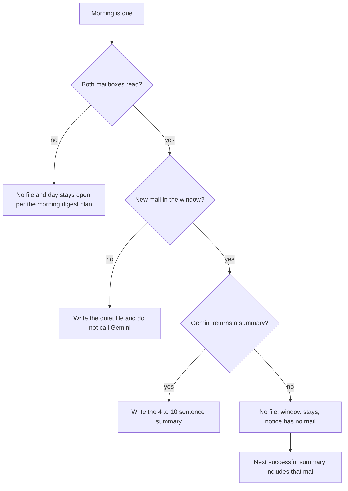
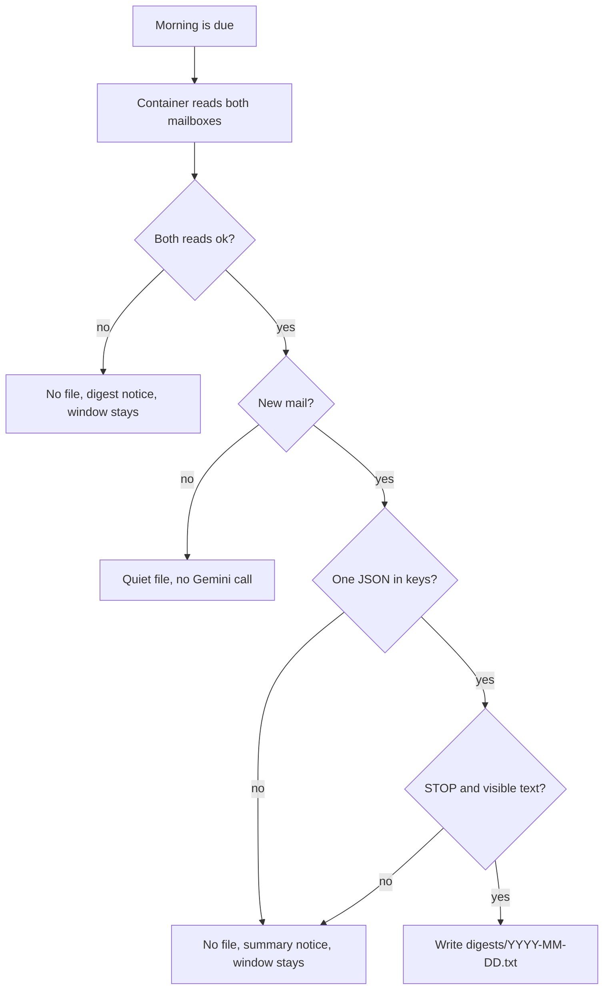

# Mail Summary - Plan

## Goal Capsule

- **Objective:** When the morning window has new mail, the day's file is a Gemini summary of what is important, about 4 to 10 sentences, billed to the Gmail Cloud project so the welcome credit pays.
- **Means:** `google-genai` on that Cloud project writes the summary into a gitignored directory of the repo (KTD1, KTD2).
- **Product authority:** Draft replies, a separate triage feature, and which provider to use after the welcome credit ends are not active scope. This Product Contract wins on behavior.
- **Stop:** Do not split the app and login images. Do not install a package on the Mac. Do not commit the service-account key or mail text. The key stays in gitignored `keys/`.
- **Open blockers:** None.
- **Execution:** code
- **Product Contract preservation:** changed: R11 — the day file moves into a gitignored repo directory. Plan 002 KTD6 no longer chooses this file's directory. R1–R10 keep their meaning.

---

## Product Contract

### Summary

On a morning with new mail, the day's file is one Gemini summary of what is important across both mailboxes, about 4 to 10 sentences, and it does not list the messages. The file lives in a gitignored directory of the repo. The call uses `google-genai` and is billed to the Gmail Cloud project. A quiet morning writes the local no-mail file and does not call the model. If Gemini does not return a summary, no file is written and that mail waits for the next successful one.

### Problem Frame

The morning file is the list of mail since the previous morning file, and the banner shows only a count. The owner wants that file to say what matters. A Google Cloud welcome credit can pay for Google's model when the call is billed to the Cloud project, and it does not pay an AI Studio key. The credit expires. Leaving the file as a list spends none of it on mail, and the morning read stays the list.

### Key Decisions

- **The morning file is the summary.** (session-settled: user-directed — chosen over a separate summary run and over a billing-only ping: the welcome credit is spent on the file the owner already opens.) Governs R1.
- **One pool of what is important.** (session-settled: user-directed — chosen over a sentence per mailbox and over a line that the rest can be ignored: a quiet mailbox may be absent.) Governs R3.
- **About 4 to 10 sentences.** (session-settled: user-directed — chosen over a ceiling of 7 and over a hard 4–7 band: this is the range to try on real mornings.) Governs R2.
- **Gemini billed to the Gmail Cloud project.** (session-settled: user-directed — chosen over an AI Studio API key and over OpenRouter: the welcome credit pays project-billed Gemini and does not pay an AI Studio key.) Governs R4.
- **Morning mail may be sent to Gemini.** (session-settled: user-directed — chosen over keeping the morning text only on the Mac: the owner allowed this mail to go to the cloud.) Governs R5.
- **A model miss leaves the window open.** (session-settled: user-directed — chosen over a failure file that closes the day and over writing the message list: the mail waits for the next successful summary.) Governs R7, R8, R10.
- **A quiet morning does not call the model.** (session-settled: user-approved — chosen over a Gemini call that only says nothing arrived: the owner confirmed the synthesis.) Governs R6.
- **The banner count is the message count.** (session-settled: user-approved — chosen over announcing that one summary exists: the owner confirmed the synthesis.) Governs R9.
- **The day file lives in the repo and is not committed.** (session-settled: user-directed — chosen over Application Support and over committing the file: `STRATEGY.md` asks for a file in the repo, and mail text must stay out of git.) Governs R11.

<!-- ce-section: work-relationships -->
### How This Work Fits Together

This plan owns the morning-file summary and the Gemini call that writes it. The list below is the current picture, not a committed roadmap.

- Local morning digest. This plan depends on it for when the morning runs, which mail is in the window, the count-only banner, the quiet-morning file, and a failed mailbox read. This plan replaces that plan's file body and moves the day-file directory. See `docs/plans/2026-09-28-002-feat-local-morning-digest-plan.md`.
- A separate triage feature. Still to decide. Can proceed independently of this plan.
- Draft replies. Still to decide. Can proceed independently of this plan.
- Which provider to use after the welcome credit ends. Still to decide. This plan does not switch providers when the credit runs out.
- Telegram send of a digest. Can proceed independently of this plan. See `docs/plans/2026-09-26-telegram-digest-send.md`.

### Actors

- A1. Owner. Opens the morning file and sees a miss notice when the summary does not run.
- A2. Morning run. Writes the day's file or leaves the window unchanged.

### Requirements

**What the file holds**

- R1. When the morning window has new mail, that day's file is a summary of what is important and does not list the window's messages.
- R2. The R1 summary is about 4 to 10 sentences.
- R3. R1 judges both mailboxes as one pool, and a mailbox may go unmentioned when nothing in it is important.

**Who produces it**

- R4. R1 is produced by Gemini billed to the same Google Cloud project used for Gmail access.
- R5. The R4 call may receive mail from the morning window.

**Empty mornings and misses**

- R6. When the morning window has no new mail, the day's file states that there were no new messages and no model is called.
- R7. When Gemini does not return a summary, no morning file is written and the window does not advance.
- R8. Mail left unsummarized under R7 appears only in the next successful R1 summary.
- R9. On success the notification shows how many messages were in the window, not how many sentences the summary has.
- R10. An R7 miss notifies the owner that the summary did not run, and the notice includes no mail content.

**Where the file is stored**

- R11. The quiet file and the summary are date-named text files in one gitignored directory of the repo. That directory is not `~/Library/Application Support/emails-assistant/digests`.

### Key Flows

- F1. Morning with new mail
  - **Trigger:** The morning run is due, both mailboxes were read, and the window has new mail.
  - **Actors:** A2, then A1
  - **Steps:** Gemini summarizes what is important across both mailboxes. The day's file is that summary. One notification shows the message count.
  - **Outcome:** A1 opens a file of about 4 to 10 sentences and no message list.
  - **Covered by:** R1, R2, R3, R4, R5, R9
- F2. Quiet morning
  - **Trigger:** The morning run is due, both mailboxes were read, and the window has no new mail.
  - **Actors:** A2
  - **Steps:** No model is called. The day's file states that there were no new messages. The notification count is 0.
  - **Covered by:** R6, R9
- F3. Gemini does not return a summary
  - **Trigger:** The window has new mail and Gemini does not return a summary.
  - **Actors:** A2, A1
  - **Steps:** No file is written. The window stays. A1 is notified without mail content. A later successful morning includes that mail in its summary.
  - **Covered by:** R7, R8, R10

### Acceptance Examples

- AE1. Both mailboxes have new mail and Gemini returns a summary
  - **Covers R1, R2, R3, R9.**
  - **Given:** Both mailboxes have new mail since the previous morning file.
  - **When:** Gemini returns a summary.
  - **Then:** Today's file is about 4 to 10 sentences, does not list the messages, and one notification shows the message count across both mailboxes.
- AE2. One mailbox has nothing important
  - **Covers R3.**
  - **Given:** One mailbox has mail the summary judges important and the other does not.
  - **When:** R1 is written.
  - **Then:** The summary may omit the quiet mailbox.
- AE3. No new mail
  - **Covers R6, R9.**
  - **Given:** The window has no new mail.
  - **When:** The morning run finishes.
  - **Then:** The file states that there were no new messages, no model is called, and the notification count is 0.
- AE4. Gemini misses, then a later morning succeeds
  - **Covers R7, R8, R10.**
  - **Given:** The window has new mail and Gemini does not return a summary.
  - **When:** A later morning succeeds.
  - **Then:** The missed run writes no file and notifies without mail content. The missed calendar day does not get its own file. The later summary includes the mail the miss left behind.

### Scope Boundaries

- Draft replies.
- A separate triage feature. R3 is a summary of what is important, not that feature.
- OpenRouter and an AI Studio API key.
- Choosing a provider when the welcome credit ends. Until then, R4 stays Gemini on the Gmail Cloud project.
- Changing the 4 to 10 sentence range after real mornings.
- The manual digest, the morning schedule, the window rule, and a failed mailbox read. Those stay in `docs/plans/2026-09-28-002-feat-local-morning-digest-plan.md`. R11 moves only the directory.
- Splitting the app and login images. See `docs/plans/2026-10-19-split-images-note.md`.

### Deferred to Follow-Up Work

- Reading the old Application Support files so the first morning in `digests/` keeps the previous file's modification time.
- Mounting the repo read-only in `scripts/macos-daily.sh`. R11 needs that mount to stay writable.
- Replacing the Keychain write that passes a secret to `security -w`.
- Daily tests replace `gemini_key_path` and never open the real file in `keys/`. The lookup test uses a temporary root. Sort out how those tests should find the key.

### Dependencies / Assumptions

- This plan assumes the Google Cloud project used for Gmail access is the billing account that holds the welcome credit. If it is not, R4 does not spend that credit.
- A failed mailbox read is unchanged from the morning digest plan: no file, a notice with no mail content, and the day stays open. R7 applies only after both mailboxes were read.
- The welcome credit does not pay Gemini API usage in AI Studio. It can pay Gemini billed to the Cloud project. See Sources.
- `STRATEGY.md` asks for the summary as a file in the repo and resists removing that file in favor of sending only to an AI system. R11 is that file, gitignored so the mail text is not committed.

### Sources / Research

- `docs/plans/2026-09-28-002-feat-local-morning-digest-plan.md` — morning window, quiet file, count-only banner, failed mailbox read.
- `README.md` — mailbox contents go to a third-party API only when the owner asks. R5 is that ask.
- [Google Cloud Free Trial](https://docs.cloud.google.com/free/docs/free-cloud-features) — the $300 welcome credit cannot pay for Gemini API in AI Studio, and it cannot pay for a partner model sold as a managed API.
- [Gemini Enterprise Agent Platform](https://cloud.google.com/products/gemini-enterprise-agent-platform) — new customers can spend the welcome credit on this platform, formerly Vertex AI.
- `STRATEGY.md` — the summary is a local file in the repo, and reply drafts stay out.
- `docs/plans/2026-10-19-split-images-note.md` — future `app` and `login` images. This plan does not build that split.

---

## Planning Contract

### Key Technical Decisions

- KTD1. **Store day files in gitignored `digests/`.** One `YYYY-MM-DD.txt` per local day. `resolve_daily_dir` defaults to that directory in the repo. `EMAILS_ASSISTANT_DAILY_DIR` still overrides it. The morning script points the container at `digests/` on the repo mount and does not mount Application Support for this file. An empty directory has no prior file, so the window is the previous 24 hours and does not read Application Support. (session-settled: user-directed — chosen over Application Support and over committing the file: the strategy asks for a file in the repo, and mail text must stay out of git.) Governs R11.
- KTD2. **Call Gemini with `google-genai` on the Gmail project.** Enterprise mode, location `global`, model `gemini-3.8-flash`. `project_id` comes from the service-account file in KTD3. Do not ship `gemini-2.5-flash`. Do not set an API key. Pin `google-genai` in `requirements.txt` and `pyproject.toml`. The login path imports `auth` and `config` only and does not import this client. (session-settled: user-directed — chosen over stdlib `urllib` and over `gemini-3.1-flash-lite`: the owner asked to install the current client, and the summary has to judge what is important.) Governs R4.
- KTD3. **The Gemini service account lives in gitignored `keys/`.** One JSON file. The morning container reads it from the repo mount and obtains its own token. The host does not mint a bearer and does not put one on stdin. There is no `gemini-caller` Keychain item. Mailbox OAuth stays in Keychain. A missing file, or more than one JSON in `keys/`, leaves a non-empty morning as R7 and still writes the quiet file. The private key stays out of git, stdout, stderr, logs, and the banner. (session-settled: user-directed — chosen over Keychain account `gemini-caller` and over the host minting a one-hour bearer: the owner is keeping the file in `keys/` for now, and the container uses it.) Governs R4, R6, R7.
- KTD4. **Send the existing summary input, uncut.** Per message: alias, subject, from, date, and the plain body or else the snippet. No message id. Do not drop messages to fit the model. An over-limit request is R7, not a shorter summary. (session-settled: user-directed — chosen over subject and snippet only: the owner kept the body so R1 can judge what is important.) Governs R5, R8.
- KTD5. **Write the file only for a finished answer.** `finishReason` is `STOP`, and the text is the non-thought parts, non-empty after stripping. Safety blocks, `MAX_TOKENS`, an empty body, and HTTP errors are R7. The 4-to-10 sentence band is in the prompt, before the mail and again after it. Do not reject a finished summary with a sentence counter. Do not set a tight output cap. The R10 notice is `Summary did not run.` The container prints that sentence and exits non-zero. It does not print `Daily digest did not run.` for this miss. The host records the miss in a file that is not `*.txt` and does not move the window. A later process the same local day sees that marker, does not call Gemini, and does not send a second banner. The next local day ignores the marker. Mailbox, token, and Docker failures stay `Daily digest did not run.` and still retry every 15 minutes. Governs R2, R7, R10.

### High-Level Technical Design

The host owns the clock, the Gmail one-shot, and the banner. The container owns the mailbox read, the service-account file on the repo mount, the `google-genai` call, and the file under `digests/`. Prompt text, mail, the service-account private key, and the raw error body stay off stdout, stderr, logs, and the banner.

### Assumptions

- The service-account JSON in `keys/` includes `project_id`. If it does not, or the file is missing, a morning with mail is R7.
- The container loads that file and the client obtains a token. The host does not mint one.
- The Agent Platform API is enabled on the Gmail project, and the service account has `roles/aiplatform.user` there. The container cannot enable the API.
- The first morning after R11 uses the previous 24 hours. Mail already covered by an Application Support file can appear again. Mail older than 24 hours is not pulled in from those old files.

### Sequencing

U1 moves the directory. U2 calls Gemini into that directory and reads the key from `keys/`. U3 supplies the R10 notice.

### Risks

- A prompt over the model input limit, or a safety block, cannot succeed on a retry. KTD5 waits until the next local day instead of calling Gemini every 15 minutes. The window stays on the last written file. R8 still forbids trimming the mail and then writing.
- The repo mount stays writable, so the morning container can change the checkout. The host does not reset that tree after the run. A reset would discard the owner's own edits. R11 needs the write for `digests/` only.
- `gemini-2.5-flash` retires on 2026-10-20. KTD2 pins `gemini-3.8-flash` instead.
- Leaving enterprise mode unset bills AI Studio, which the welcome credit does not pay.

### Sources / Research

- `src/emails_assistant/daily.py` — `decide_daily` already replaces the list with a non-blank summary, treats a blank summary with mail as `SUMMARY_MISS`, and ignores `summary` when the window is empty. `render_summary_input` is the KTD4 payload. `_run_daily` still passes `summary=None`.
- `scripts/macos-daily.sh` — retries every 15 minutes until today's file exists or the local day ends. The repo mount is writable. The banner allows only letters, digits, spaces, and dots.
- `docs/dev.md` — mail commands do not call the token endpoint. Keychain stays on the Mac.
- `docs/solutions/security-decisions/2026-10-17-host-script-review-before-merge.md` — do not add a `security -w` writer. The container already has a Gmail token and network.
- `docs/plans/2026-10-17-feat-mac-login-plan.md` — no new package on the Mac. Login stays a one-shot container.
- [Agent Platform quickstart](https://docs.cloud.google.com/gemini-enterprise-agent-platform/models/start) — enterprise client, `roles/aiplatform.user`, `generateContent`.
- [Model versions](https://docs.cloud.google.com/gemini-enterprise-agent-platform/models/model-versions) — `gemini-2.5-flash` retires 2026-10-20. `gemini-3.8-flash` is the named replacement.
- [Welcome credit](https://ai.google.dev/gemini-api/docs/billing) — the credit does not pay Gemini API in AI Studio.

---

## Implementation Units

### U1. Day-file directory

- **Goal:** Write the quiet file and the summary under gitignored `digests/` in the repo.
- **Requirements:** R11. The window rule stays the morning digest plan's rule.
- **Dependencies:** None.
- **Files:** `src/emails_assistant/daily.py`, `.gitignore`, `scripts/macos-daily.sh`, `tests/test_daily_rules.py`, `docs/dev.md`
- **Approach:** Default `resolve_daily_dir` to `digests/` in the repo. Keep the env override. Point the morning container at that directory on the repo mount, and stop mounting Application Support for the day file. Add `digests/` to `.gitignore`. Do not copy old files.
- **Patterns to follow:** `decide_daily` and `_window_start` in `src/emails_assistant/daily.py`. The morning mount list in `scripts/macos-daily.sh`.
- **Test scenarios:**
  - No env override. The directory is `digests/` under the repo root, not Application Support.
  - `EMAILS_ASSISTANT_DAILY_DIR` still wins.
  - An empty directory and clock T. The window starts 24 hours before T.
  - A prior `digests/*.txt` modified at M. A message at M is outside. A message after M is inside.
  - `.gitignore` ignores `digests/`.
- **Verification:** `python -m pytest tests/test_daily_rules.py` passes. A run with no override does not create a file under Application Support.

### U2. Gemini summary

- **Goal:** When the window has mail, the day's file is the Gemini summary.
- **Requirements:** R1, R2, R3, R4, R5, R6, R7, R8. Covers F1, F2, F3, AE1, AE2, AE3, AE4.
- **Dependencies:** U1
- **Files:** `src/emails_assistant/summary.py`, `src/emails_assistant/cli.py`, `requirements.txt`, `pyproject.toml`, `tests/test_daily_command.py`, `tests/test_summary.py`
- **Approach:**
  - Pin `google-genai` in both manifests. The owner has approved that install. Do not add it to the login import path.
  - After both mailboxes read, call Gemini only when `render_summary_input` is non-empty. Pass that text per KTD4.
  - Build an enterprise client per KTD2 from the one JSON in `keys/`. The client obtains its own token.
  - Pass a non-blank summary into `decide_daily`. A miss passes a blank summary so the existing `SUMMARY_MISS` branch writes nothing, then prints `decision.failure` (`Summary did not run.`) and exits non-zero. `_daily_fail` stays for mailbox, token, and Docker failures.
  - Keep `digest` from writing a day file.
- **Execution note:** Tests fake the client. They do not call Gemini, Gmail, or Keychain.
- **Patterns to follow:** `decide_daily` in `src/emails_assistant/daily.py`. `_run_daily` in `src/emails_assistant/cli.py`. Fake Gmail services in `tests/test_daily_command.py`.
- **Test scenarios:**
  - Covers AE1. Both mailboxes have mail and the fake client returns `STOP` with visible text. The file is that text, has no subject line from the list, and stdout is the message count.
  - Covers AE2. The returned text names one mailbox only. The file is still written.
  - Covers AE3. No mail in the window. The client is not called. The file says there were no new messages, and stdout is `0`.
  - Covers AE4. The client returns a safety block, `MAX_TOKENS`, empty text, or thought parts only. No file is written, stdout is exactly `Summary did not run.`, and the missed messages stay inside the next window.
  - `STOP` text that is not 4 to 10 sentences is still written.
  - The request sent to the fake client includes the body when present, otherwise the snippet, plus subject, from, and date. It includes no message id.
  - A quiet morning still writes the quiet file and does not call the client.
  - A morning with mail and no key file writes no file.
  - `digest` prints and does not write a day file.
- **Verification:** `python -m pytest tests/test_summary.py tests/test_daily_command.py tests/test_daily_rules.py` passes without network.

### U3. Miss notice

- **Goal:** An R7 miss tells the owner the summary did not run, once, and does not call Gemini again that day.
- **Requirements:** R7, R9, R10. Covers F3, AE4.
- **Dependencies:** U2
- **Files:** `scripts/macos-daily.sh`, `tests/test_macos_daily.sh`, `docs/dev.md`
- **Approach:**
  - The Gemini key is the KTD3 file on the repo mount. Do not mint a bearer on the host.
  - When the container stdout is exactly `Summary did not run.` and today's file is absent, write the KTD5 marker and show that sentence once. A later process the same local day does not call Gemini and does not show the sentence again.
  - Leave the repo mount writable. In `docs/dev.md`, name `digests/` and `keys/`. Do not describe a `gemini-caller` Keychain item. Do not show a `security -w` command.
- **Patterns to follow:** The retry loop and `notify` in `scripts/macos-daily.sh`.
- **Test scenarios:**
  - A summary miss writes the KTD5 marker, which is not a `*.txt` file. A second process the same local day does not call Gemini and does not send a second banner. The window stays on the last `*.txt`. A mailbox failure still retries after 15 minutes.
  - The container exits non-zero with stdout `Summary did not run.` and no day file. One banner is that sentence, and it contains no subject.
  - The container exits non-zero with stdout `Daily digest did not run.` One banner is that sentence.
  - The container writes today's file and prints a count. The banner is that count.
  - A second failure in the same process does not send a second banner.
- **Verification:** The host shell tests pass without Keychain, Docker, or Gemini. `docs/dev.md` names `digests/` and `keys/`.

---

## Verification Contract

- `python -m pytest tests/test_daily_rules.py tests/test_daily_command.py tests/test_summary.py` passes with no network.
- The host tests in `tests/test_macos_daily.sh` and `tests/test_host_refresh.sh` pass without Keychain, Docker, or Gemini.
- `digest` still prints and does not write a day file.
- The git diff contains no token, no service-account key, no `.env`, and no mail body. `digests/` and `keys/` are gitignored.
- `requirements.txt` and `pyproject.toml` pin the same `google-genai` version. The login module does not import it.

---

## Definition of Done

- U1, U2, and U3 meet their verification.
- R1 through R11 hold.
- The day file is under `digests/` in the repo, and that directory is gitignored.
- A miss writes no file, leaves the window, and notifies with `Summary did not run.`
- The Mac has no new package. The service-account key stays in gitignored `keys/` and is not committed. The morning container reads that mounted file.
- The app and login images are not split in this change.
- Abandoned experiment code is not left in the diff.
