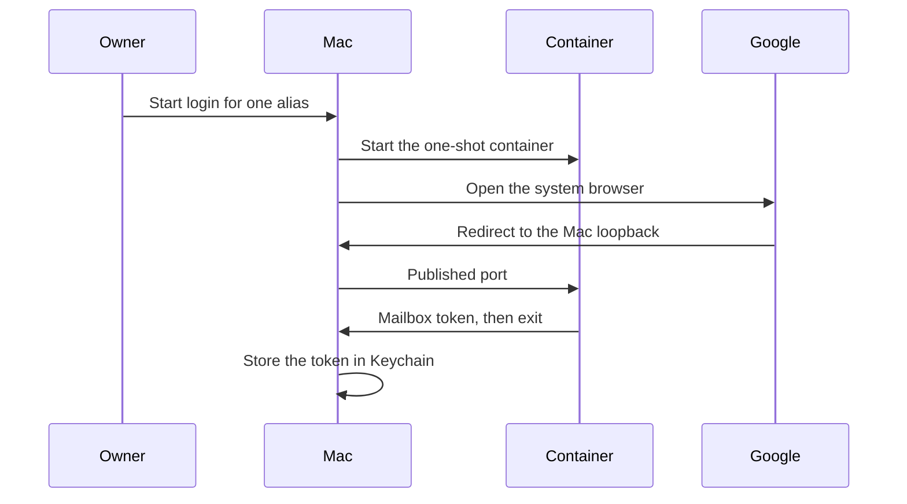

# Mac Login - Plan

## Goal Capsule

- **Objective:** The owner can replace a rejected mailbox refresh token from the Mac, and the browser redirect reaches the login that returns the new token for Keychain.
- **Means:** Start a one-shot container whose consent port is published on the Mac loopback, store the returned token in Keychain, and remove the Dev Container login path.
- **Authority:** This Product Contract wins on behavior.
- **Stop:** Do not move mail reading onto the Mac. Do not publish or verify the Google OAuth client. Do not add a host package. Do not keep the Dev Container login path. Do not add a long-running login container. Do not change the morning curl refresh, except that a rejected refresh still asks the owner to log in.
- **Execution:** code
- **Open blockers:** None.

---

## Product Contract

### Summary

Login for one mailbox starts on the Mac and runs in a one-shot container. The Mac opens the system browser, the redirect arrives on the Mac loopback and reaches that container, and the host stores the returned mailbox token in Keychain. The container then exits. The old Dev Container login path is removed. Mail commands still receive only a short-lived access token.

### Problem Frame

Google rejected the `email1` refresh token, so the owner had to sign in again. Consent then started inside the open Dev Container, while the browser was on the Mac. The browser opened a localhost address that nothing on the Mac was listening on, and the connection was refused. That Dev Container did not publish the consent port. A Testing-status OAuth client expires refresh tokens about every seven days, so this login will recur.

### Key Decisions

- **One-shot login container.** (session-settled: user-approved — chosen over installing the Google auth libraries on the Mac and over a long-running second container: the browser still uses the Mac loopback, and the container exits after it returns the token.) Governs R1, R2, R3.
- **No new package on the Mac.** (session-settled: user-approved — chosen over running the Google auth libraries on the host: the morning job is unattended and only posts the refresh token.) Governs R6, R7.
- **Remove the old login path.** (session-settled: user-directed — chosen over leaving Dev Container login in place: implementation must remove that legacy path.) Governs R4, R10.
- **Mail reading stays in the container.** Governs R6.

### Requirements

**Consent**

- R1. For one alias at a time, the owner starts login on the Mac, the Mac opens the system browser, and Google's redirect arrives on the Mac loopback and reaches the one-shot container started for that login.
- R2. The host passes the OAuth client secret into that container for the run only, stores the returned mailbox token in Keychain, and the container keeps neither the secret nor the token after it exits.
- R3. Login does not take a Dev Container name, and the owner does not forward a port by hand.
- R4. Shipping this removes the Dev Container login path, so the Mac one-shot login is the only way to obtain a new refresh token.
- R5. If the system browser cannot be opened, the command shows the authorization URL in the terminal and still waits for the same loopback redirect.

**Mail after login**

- R6. After a successful login, the existing curl refresh and access-token handoff for that alias work without a second consent, and mail commands still see only a short-lived access token.
- R7. Login and the morning refresh do not install or require a new host package.

**Failure and the other mailbox**

- R8. If the owner denies consent, or the wait ends without a redirect, the command fails and Keychain keeps the previous token for that alias. The failure text contains no secret and no mail text.
- R9. Login for one alias does not change the other alias's stored token.

**Instructions**

- R10. Owner-facing login instructions describe the Mac command and do not tell the owner to pass a container name, forward a port, or start consent in the Dev Container.

<!-- ce-section: work-relationships -->
### How This Work Fits Together

This plan covers replacing a rejected refresh token. The breakdown below is the current understanding, not a roadmap.

- Mail reading, inject, and the morning file depend on a usable refresh token. They keep their current behavior once login works. This plan does not redesign them.
- Publishing or verifying the Google OAuth client is still to decide. It is outside this plan.

### Actors

- A1. Owner. Starts login and answers the consent page in the system browser.
- A2. Mac host login. Starts the one-shot container, opens the browser, and writes Keychain.
- A3. One-shot container. Runs consent for that login and exits.
- A4. Google authorization server. Shows consent and redirects to the Mac loopback.

### Key Flows

- F1. Replace a rejected refresh token
  - **Trigger:** Refresh for an alias is rejected and login is required.
  - **Actors:** A1, A2, A3, A4
  - **Steps:** The owner starts login for that alias on the Mac. A2 starts a one-shot container and opens the system browser. After consent, the browser returns to the Mac loopback and that request reaches the container. The container returns the mailbox token and exits. A2 stores it in Keychain. The command finishes without printing the token.
  - **Outcome:** That alias can be refreshed and handed to mail commands as before, per R6.
  - **Covered by:** R1, R2, R6
- F2. Consent does not complete
  - **Trigger:** The owner denies access, or the redirect never arrives.
  - **Actors:** A1, A2, A3
  - **Steps:** A2 stops waiting, the one-shot container exits, and the command reports failure.
  - **Outcome:** The previous token remains, per R8.
  - **Covered by:** R8
- F3. The system browser does not open
  - **Trigger:** The Mac cannot launch the system browser.
  - **Actors:** A1, A2, A3
  - **Steps:** A2 prints the authorization URL and keeps waiting. The owner opens that URL and consents. The redirect still arrives on the Mac loopback and reaches the one-shot container.
  - **Outcome:** Login stores the new token, per R2.
  - **Covered by:** R5, R2

### Acceptance Examples

- AE1. Completed consent for one alias
  - **Covers:** R1, R2, R3, R6, R9
  - **Given:** The `email1` refresh token was rejected. The `email2` token is still valid. Docker is running. The owner does not forward a port by hand.
  - **When:** The owner completes consent for `email1` in the system browser.
  - **Then:** Keychain holds a new `email1` token. The `email2` token is unchanged. The one-shot container is gone. A later curl refresh and handoff for `email1` succeed without another consent.
- AE2. The browser cannot be launched
  - **Covers:** R5, R2
  - **Given:** The system browser cannot be launched.
  - **When:** The owner starts login and then opens the printed URL and consents.
  - **Then:** Login stores the new token. The one-shot container exits after the token is returned.
- AE3. Consent denied
  - **Covers:** R8, R9
  - **Given:** `email1` already has a Keychain token.
  - **When:** The owner denies consent.
  - **Then:** The command fails. The `email1` token is unchanged. The message contains no token and no mail text. The one-shot container is gone.
- AE4. The old login path is gone
  - **Covers:** R4, R10
  - **Given:** The owner follows the documented login steps.
  - **When:** Those steps run.
  - **Then:** Consent uses the one-shot container, not the Dev Container. The docs do not ask for a container name. No second login command remains.

### Scope Boundaries

- Publishing or verifying the Google OAuth client, including the roughly seven-day Testing refresh-token lifetime.
- Moving mail reading onto the Mac.
- Installing the Google auth libraries on the Mac.
- A long-running login container.
- The login attempt already waiting inside the current Dev Container. That attempt is the old path.
- Digest text, search, message display, and the morning file format.

The image split in `docs/plans/2026-10-19-split-images-note.md` has landed. Login uses `emails-assistant:login`. The morning job uses `emails-assistant:app`. Host scripts live under `src/host/`. That split does not change the requirements above. `docs/dev.md` describes `src/host/access-token/access-token.sh login <alias>`.

**Deferred to Follow-Up Work**

- Move the embedded `HOST_PY` out of `src/host/access-token/access-token.sh`. Refresh and `inject` stay on that curl path.

### Dependencies / Assumptions

- The OAuth client already accepts a loopback redirect. Today's consent reached a localhost URL in the Mac browser before the connection was refused.
- Keychain already holds the OAuth client secret and the mailbox tokens.
- Keychain is unlocked for reads and writes during login, as it is for the current host refresh.
- Docker is running for login, as it is for the morning job.

### Sources / Research

- [OAuth 2.0 for desktop apps](https://developers.google.com/identity/protocols/oauth2/native-app). Google's recommended redirect for a macOS app is a loopback address on the machine where the system browser runs.
- `docs/plans/2026-09-28-001-feat-access-token-handoff-plan.md`. Consent runs in the container, and the plan leaves the missed Mac redirect for later.
- `docs/dev.md`. Login is `src/host/access-token/access-token.sh login <alias>`. The owner does not pass a container name.
